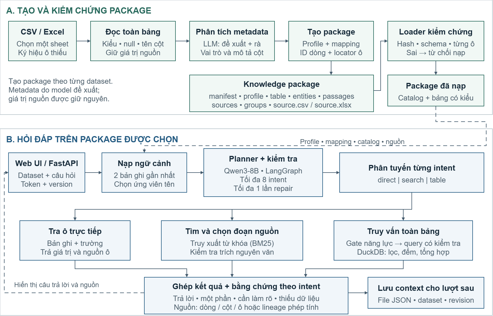

# G8.5 — Tự động tạo package từ dữ liệu dạng bảng cho hệ thống LLM

Bản hiện tại thay deployment document-RAG cũ bằng **workspace upload CSV/XLSX → tự tạo package → hỏi đáp**. API, web tĩnh, loader và runtime nằm trong thư mục này; không cần snapshot G8 hay package/dataset của tác giả.



## Nguyên lý

1. `Table` đọc bảng, xác định kiểu/ô thiếu/tính duy nhất, mẫu giá trị và SHA-256; không tự giải mã mã số hoặc đơn vị.
2. `package_builder.analyze` gọi LLM đề xuất metadata, rồi rà mô tả/cột tên hiển thị. Đây vẫn là đề xuất, không phải nhãn nghiệp vụ đã được chuyên gia duyệt.
3. Chương trình tạo mapping, ID dòng, bằng chứng từng ô và locator từ nguồn; giữ dòng trùng tên riêng biệt, phân biệt null với số 0.
4. Loader kiểm tra schema/hash, mapping và liên kết từng ô trước khi nạp.
5. `package_runtime` nối với planner/engine: tra trực tiếp bản ghi + trường, BM25 lấy đoạn hoặc compiler/DuckDB truy vấn toàn bảng. Không lấy top-k ứng viên làm đáp án cho danh sách toàn bảng.

```text
manifest.json      phiên bản, hash, số lượng file/bản ghi
profile.json       phạm vi, trường, capability, giới hạn
table.json         cấu trúc vật lý và mapping cột
entities.jsonl     ID/tên từng dòng, không gộp tên trùng
passages.jsonl     bằng chứng nguyên văn từng ô có giá trị
sources.jsonl      định danh nguồn
groups.json        nhóm bản ghi
source.csv/xlsx    file nguồn để đối chiếu lại
```

Package tự động không được đánh dấu đã được con người duyệt. Loader kiểm tra tính toàn vẹn/liên kết nguồn, không chứng minh model hiểu đúng mọi câu hỏi.

## Cập nhật 22/10/2026

- Câu đếm dòng, tên cột/giá trị được ghi rõ và số dòng vật lý có thể thực thi trực tiếp qua compiler có tham số. Cách hỏi có điều kiện chưa hiểu được vẫn qua planner.
- Tách phạm vi từng intent khi lập kế hoạch và repair; dấu phân cách trong giá trị được trích dẫn không tạo thêm intent. Hỏi cùng trường của hai bản ghi giữ hai điều kiện độc lập.
- Đối chiếu số dòng, biến thể tên, các nhãn văn bản ngắn khớp chính xác nguồn; giữ nhiều dòng trùng tên. Trường không có trong nguồn không được thay bằng trường khác như email thay điện thoại.
- Chuỗi có dấu nháy/backslash/escape được đối chiếu với giá trị nguồn; ô thiếu và giới hạn danh sách được báo rõ bằng `partial`.
- Nạp bảng theo lô JSON có tham số, giữ kiểu dữ liệu, thứ tự dòng và bằng chứng. Đầu ra model bị cắt đi qua repair có giới hạn.

Lượt kiểm tra API trên 11 dataset đạt đủ tiêu chí 218/221, DEV 176/176; ba ca `partial` còn lại và phạm vi đánh giá được ghi tại [report](../report/README.md). PDF về hệ thống tự tạo package nằm [tại đây](../report/RP2_he-thong-tu-dong-tao-package.pdf).

## Chạy bằng Docker

Chuẩn bị model `/v1/chat/completions` hỗ trợ JSON-schema output. Tham chiếu: Qwen3-8B Q4_K_M qua llama.cpp; xem [README gốc](../README.md#chạy-trên-máy-riêng). Không kèm weights hay tự khởi động model của tác giả.

```powershell
# Trong thư mục G8.5-He-thong-LLM-reusable
Copy-Item .env.example .env
# G85_MODEL_URL: endpoint /v1, container phải gọi được.
# G85_MODEL_NAME: alias đúng trên model server.
docker compose --env-file .env config --quiet
docker compose up -d --build --wait
```

Mở **http://localhost:13085**. UI, API, `/docs`, `/health` cùng origin. Một process Uvicorn, một worker xử lý, tối đa tám yêu cầu đang xử lý/chờ cộng lại. Không tăng `--workers` khi chưa có queue/khóa dùng chung.

File/package/context lưu trong volume `datasets`. `docker compose down` giữ volume, **`down -v` xóa dữ liệu**. Không import volume PostgreSQL của G8.5 cũ vào workspace này. Bản source cũ vẫn có trong lịch sử Git.

## Dùng giao diện

- Bấm **Thêm bảng dữ liệu** hoặc kéo thả CSV/XLSX. Có thể thử `examples/devices.csv`: dữ liệu giả lập, không phải quy định cho mượn thiết bị thật.
- Header ở dòng đầu; workbook nhiều sheet cần nhập đúng tên sheet. Hệ thống không tự chọn sheet theo ý định người dùng.
- Ký hiệu ô thiếu là tùy chọn: khai báo khi nguồn quy định `NA`, `?` hoặc giá trị khác là thiếu; mặc định không coi mọi chữ `NA` là null.
- Chọn bảng bên trái để hỏi. Có thể giữ nhiều dataset và chuyển qua lại, nhưng mỗi câu hỏi chỉ chạy trên một dataset, chưa join các bảng.
- **Cấu trúc dữ liệu** có header, metadata/cảnh báo và tải package ZIP. Kết quả có mở nguồn, sao chép, tải CSV; UI có tìm bảng, đổi tên hiển thị, xuất hội thoại, sáng/tối và bố cục di động.

Ví dụ với bảng giả lập:

> Alpha có `deposit_vnd` bao nhiêu và Beta có `return_days` bao nhiêu?
>
> Bảng có bao nhiêu dòng và trung bình `return_days` là bao nhiêu?
>
> Liệt kê `name` và `return_days` khi `deposit_vnd = 0`.

Tối đa **8 intent/lượt**. Context giữ **hai bản ghi gần nhất được xác định**, không nhớ cả danh sách kết quả. Dataset/package version và revision bảo vệ ranh giới ngữ cảnh/ghi đồng thời.

Danh sách bảng, token và lịch sử UI nằm trong `sessionStorage` của tab. Reload giữ phiên tab; đóng tab/xóa dữ liệu có thể mất danh sách hiển thị. File/context vẫn còn ở server; chưa có đồng bộ tài khoản hoặc khôi phục token đã mất.

## Python, API và CLI

Python 3.12, từ thư mục G8.5:

```powershell
python -m venv .venv
.venv/Scripts/python.exe -m pip install -r requirements.txt
$env:G85_MODEL_URL = 'http://127.0.0.1:18085/v1'
$env:G85_MODEL_NAME = 'G85-Tabular-Qwen3-8B-Q4'
.venv/Scripts/python.exe -m uvicorn g85.tabular_lab.service:app --host 127.0.0.1 --port 8086 --workers 1 --no-access-log
```

Linux/macOS dùng `.venv/bin/python` và cú pháp môi trường phù hợp. `G85_DATA_DIR` tùy chọn đổi thư mục lưu; mặc định `.runtime/g85-tabular-service/datasets`.

Upload API dùng **raw body**, không phải multipart; ví dụ khi API local chạy cổng 8086:

```powershell
$dataset = Invoke-RestMethod -Method Post -Uri 'http://127.0.0.1:8086/v1/datasets?filename=devices.csv' -ContentType 'text/csv' -InFile examples/devices.csv
$headers = @{ 'X-Dataset-Token' = $dataset.dataset_token }
$body = @{ version = $dataset.version; question = 'Bảng này có bao nhiêu dòng?' } | ConvertTo-Json
Invoke-RestMethod -Method Post -Uri "http://127.0.0.1:8086/v1/datasets/$($dataset.dataset_id)/query" -Headers $headers -ContentType 'application/json; charset=utf-8' -Body ([System.Text.Encoding]::UTF8.GetBytes($body))
```

Giữ token phía người gọi, không đưa vào URL, Git hay logs. Schema đầy đủ ở `/docs`:

| Route | Chức năng |
| --- | --- |
| `POST /v1/datasets?filename=...` | Upload/tạo package, trả ID, source version và token |
| `GET /v1/datasets/{id}` | Đọc profile, cần `X-Dataset-Token` |
| `POST /v1/datasets/{id}/query` | `question` + `version`, tùy chọn cặp conversation/revision |
| `GET /v1/datasets/{id}/package` | Tải ZIP, cần token |
| `POST /v1/datasets/{id}/conversations` | Tạo context, body `version` |
| `GET /v1/datasets/{id}/conversations/{conversation_id}` | Đọc context/revision |

Sai token/ID: 404; version/hash/revision: 409; input lỗi: 422; file quá lớn: 413; queue đầy: 429; lỗi xử lý/model: 503. `/health` không kiểm tra readiness/chất lượng model.

CLI tạo package cần model sẵn sàng; output phải là thư mục **mới**:

```powershell
.venv/Scripts/python.exe -m g85.package_builder --input examples/devices.csv --output .runtime/packages/devices-v1
# Excel: thêm --sheet 'Tên sheet'.
# Ký hiệu thiếu theo nguồn: thêm --missing-values '["","?"]'.
```

`g85/ingest.py` còn hỗ trợ document JSONL/CSV với profile/mapping chuẩn bị riêng. Đây là đường tùy chọn, không phải upload bảng tự động. UI hiện chưa có upload ZIP package để activate trực tiếp.

## Kiểm thử

```powershell
.venv/Scripts/python.exe -m pytest g85/tests g85/tabular_lab -q
```

180 test offline kiểm tra đọc bảng, null/số lớn, schema/hash/binding, multi-intent, context/revision, token isolation, queue, cấu hình endpoint và các lỗi ràng buộc yêu cầu bảng. Model giả lập không đo accuracy LLM.

UI acceptance dùng API giả lập, không gọi model:

```powershell
npm ci --prefix tools
npx --prefix tools playwright install chromium
node g85/tabular_lab/ui_redesign_smoke.cjs
```

## Giới hạn và public deployment

- CSV UTF-8/XLSX, một bảng có header/một sheet; tối đa 20 MiB, 32 cột, 100.000 ô. Từ chối header trùng, input rỗng và công thức Excel. Chưa có workbook tự do, join, group-by, top-N hay quy đổi đơn vị.
- Lọc literal, đếm và tổng hợp chạy trên toàn bảng. Điều kiện cần hiểu phủ định/ngoại lệ trong văn bản không được thay bằng kiểm tra từ khóa; bộ lọc ngữ nghĩa chưa bật trong API.
- Không suy ra chính sách, ý nghĩa mã hoặc đơn vị ngoài nguồn. Ô thiếu không tự là 0. BM25 là tìm kiếm từ khóa; planner và metadata vẫn có thể sai, chưa có bảo đảm đúng với mọi dataset/cách hỏi.
- Policy nghiệp vụ cần được người phát triển đăng ký tin cậy và kiểm thử; không chạy mã từ dataset. Các thử nghiệm kiểm tra semantic lookup không được âm thầm bật trong API.
- Compose chỉ bind localhost. Token theo dataset chưa thay user/tenant auth, thu hồi token, quota, audit hay chính sách xóa dữ liệu. Public cần bổ sung các lớp này và HTTPS; không public model server trực tiếp.

Không kèm dataset ngoài, weights, history, upload hay token thật. Font/icon có giấy phép trong `g85/tabular_lab/static/assets/`.
